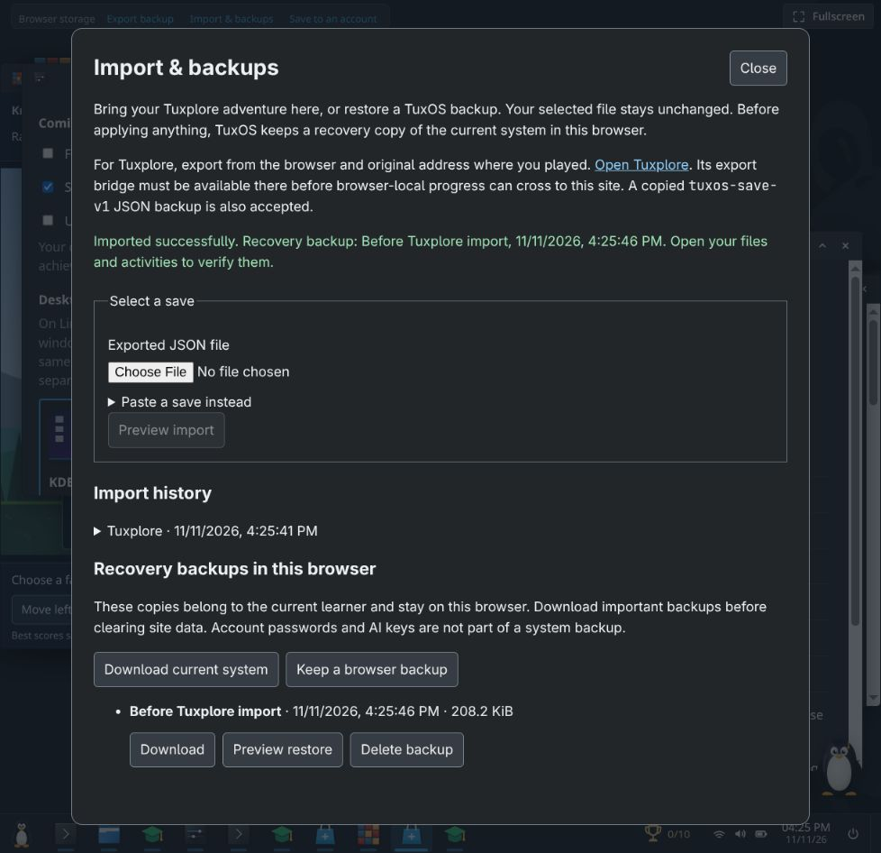
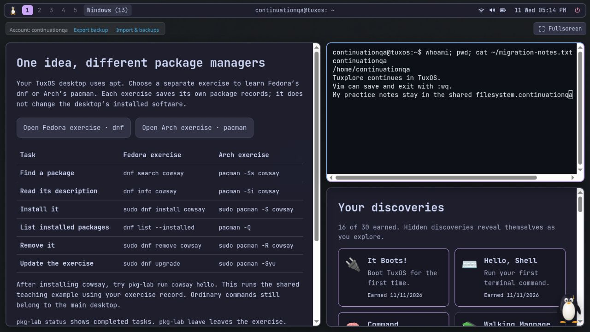

# Tuxplore → TuxOS implementation report

11 November 2026 · Branch `codex/tuxplore-continuation` · Base `2562174` · Application candidate `ef75db9`

The local continuation candidate is implemented and committed. TuxOS now offers immediate guest exploration,
Tuxplore’s recognizable activities, shared desktop learning, validated save migration and recovery, and a
prepared release/export path. Production has not been changed and Tuxplore has not been retired.

The engineering work across phases 0–7 is complete locally. The plan’s human beta, physical-device checks,
original-origin export deployment, real account-export verification and production retirement remain open exit
conditions. They cannot be replaced by automated tests or fictional user feedback.

## What changed

| Area | Result |
| --- | --- |
| Entry and access | Explore immediately without an account or working account API. Four desktop styles and ordinary apps are available independently of lessons. Fast boot, chosen context and saved windows resume. Earned history and the anniversary cosmetic are retained. |
| Learning experience | One Learn Linux surface works in a desktop window or focus view. Instructions, Terminal and Files can stay together. Normal clipboard use, free help, non-blocking rewards and bounded terminal context reduce interruptions. |
| Desktop convenience | Curated shortcuts, Files Places/breadcrumbs/preview/terminal-here, folder and view persistence, singleton app policies, multiple terminals, unsaved editor guards, clamped geometry, touch controls and pointer cancellation. A browser-discovered Hyprland issue now uses readable tile groups and a window switcher for large restored sessions. |
| Tuxplore activities | All ten Adventure quests, eight Pipe Dream levels, Know Your Distro Rapid/Infinite modes, family map, records and preferences; thirty discovery triggers; searchable/printable learned-command reference; four-question Try Linux guide with six distributions. |
| Teaching commands | `man`/`whatis`, useful typo and Windows-command suggestions, bounded nano/Vim practice editors, additional exploration commands and secrets, and separate Fedora/dnf and Arch/pacman exercises. Existing apt/dpkg depth remains. |
| Vasu | Useful local quest/error guidance and shortcuts without AI. Lightweight 2D default, optional deferred 3D, dismiss/hide controls and cooldowns. Existing AI consent, Stop/Esc and sudo boundaries remain. |
| Migration | Versioned validation and deterministic conversion; previewed file conflicts, coherent partial-quest choice, earliest achievement timestamps, maximum compatible scores, separately preserved historical scores, supported apt equivalents, unchanged source download and persistent compatibility report. Re-import is idempotent. |
| Recovery and accounts | Mandatory browser recovery copy before replacement; stale-preview and late-write protection; backup manager, native restore and scoped exercise recovery. Explicit authenticated browser-to-account transfer supports different names without rewriting personal text. Save failures remain visible. |
| Performance and reliability | Deferred Terminal code with intent prefetch; paused inactive games; no hidden 3D rendering; local drag previews; memoized puzzle results; cheaper immutable save serialization; app-load failure boundaries and retry controls. |
| Continuation release | About/migration/history pages, welcome links, metadata/social card/manifest, preserved icons and license credits. Additive legacy greeter/Settings/About export candidate, archive candidate, deployment compatibility guard and rollback runbook. |

TuxOS’s 34 Linux lessons and 150 checked tasks, Docker course, filesystem guide, Text Editor, administration
practice, apt/Software, sandboxed plugins/widgets, account version checks and optional AI are retained. New
activities use the same kernel/filesystem and module lifecycle rather than a second embedded Tuxplore runtime.

## What the evidence says about smoothness

The original feedback pointed to friction as well as appearance: earlier desktop access required accounts,
lessons and package installation; changing learning context could interrupt desktop work; Tuxplore offered
familiar games and a smaller, more direct entry. Those concrete differences are addressed in this candidate.
Whether the people who preferred Tuxplore now prefer TuxOS still needs observation.

Using the same gzip-9 measurement, startup JavaScript fell from **249,804 to 171,109 bytes**, a **31.5% reduction**.
The final build passes the new 180,000-byte startup budget. Tuxplore remains lighter at about 103 KB in the
browser sample. The first Terminal also remains a tradeoff: a local first-open DOM sample was 317 ms in TuxOS
versus 13.2 ms in Tuxplore. Intent prefetch was added in response; a post-prefetch speedup has not been claimed.

For a synthetic 3.55 MB save, eliminating an unnecessary pre-serialization clone reduced median export CPU
from 12.039 to 7.052 ms in a Node sample. Atomic mutation rollback and save ordering remain intact. These are
local observations, not mobile frame-rate, battery or universal latency results. Full methodology, raw samples,
measurement limits and the user-comparison protocol are in [performance and beta](performance-and-beta.md).

## Verification completed

- `npm run check`: typecheck and **626 tests in 75 files pass**.
- `npm run build`: production build passes. Startup bundle budget passes.
- `npm run test:release`: **six disposable release/rollback scenarios pass**, including failed health/restart,
  incompatible readers, missing recovery releases, immutable naming and unchanged learner data.
- Browser: fresh/API-unavailable guest entry; learning/desktop continuity; Files and editor work/reload; games,
  quests and package practice; all four desktop styles; import conflicts, imported file contents/permissions,
  game records, pre-import restoration and retained backup copies.
- Browser: real disposable account authentication, renamed transfer, unchanged notes, save-error retry and
  account resume. Docker’s first task checks correctly; filesystem/Software screens and plugin permission
  review remain available. AI stayed off; no live provider key or production account was used.
- Browser: legacy candidate’s missing-save feedback, continuation notice and fictional guest export preparation;
  continuation About and migration pages. Built local page links, manifest and icon dimensions checked.

The existing jsdom/xterm canvas warning and Vite raw-chunk-size warning remain. Native print preview was not
inspectable through the browser tool; the print document’s 100-row preservation and cleanup are tested. See
the [verification matrix](verification-matrix.md) for exact coverage and unverified combinations.

## Phase disposition and retirement gates

| Phase | Local result | Still required outside this implementation |
| --- | --- | --- |
| 0 Baseline | Source/build inventory, fixtures, license and feature ledger | No historical user preference or pre-change frame traces fabricated |
| 1 Contracts/export | Access/mastery separation, compatible save contract and exporter | Publish and verify exporter at the exact original origins |
| 2 Convenience | Guest entry, resume, safe optional accounts and clipboard | Real-world device/browser acceptance |
| 3 Continuity | Shared learning/desktop workflow and window/files behavior | Physical touch/keyboard checks on target devices |
| 4 Feature parity | Signature activities, shell features, reference and guidance | Existing users accept documented bounded simulations/replacements |
| 5 Import | Validated conversion, conflict choices, backup/restore and renamed accounts | Consented volunteer migrations and authenticated legacy cloud-export check |
| 6 Validation | Local tests, browser checks, measured improvements and beta protocol | 5–8 user sessions, true cold/warm traces, lower-end devices and print pagination |
| 7 Release | Packaged candidates, identity, original-origin bridge/archive and rollback safeguards | Staged production rollout, production recovery drill, checked stats/inbound links, then a retirement date |

Do not redirect the old domain away from its local saves or remove its account service yet. Keep historical
Stats at its source until its backend/counts or a dated archive are verified. Matching usernames do not prove
account ownership. The [release runbook](release-runbook.md) contains the concrete rollout and stop conditions.

## Reviewable outputs and commits

The implementation is split into fifteen meaningful commits from `8d31deb` through `ef75db9`, followed by the
report/artifact-record commit. In order: baseline; access/save contracts; guest convenience; continuous learning;
Pipe Dream/discoveries; Adventure; Try Linux; Know Your Distro; editors/help; package families; remaining
exploration/local Vasu; migration/recovery; performance/reliability; Hyprland overflow; release/rollback.

Local release archives, with sizes and SHA-256 values in [release-artifacts.json](release-artifacts.json):

- `dist/tuxos-continuation-ef75db9.tar.gz`: application candidate and guarded deployment tooling.
- `dist/tuxos-compatible-recovery-e80d3a1.tar.gz`: preserved compatible recovery candidate.
- `dist/tuxplore-export-candidate.tar.gz`: additive legacy export/notice/archive candidate; no account backend.

These ignored build artifacts are present in this workspace, not committed binaries or published releases.
The source, reports, tests, metadata and screenshot evidence are committed. No branch push, deployment,
retirement notice, production account change or user-recruitment message was performed.
